<p align="center">
  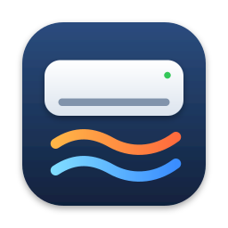
</p>

<h1 align="center">Husly</h1>

<p align="center">
  A Mac app for the home's climate and energy: control and monitor a Mitsubishi Electric heat pump through MELCloud, follow electricity use with Tibber and indoor air with Airthings, with Claude as an advisor.
</p>

<p align="center">
  <a href="https://github.com/stigoleg/Husly/actions/workflows/ci.yml"></a>
  <a href="https://github.com/stigoleg/Husly/releases/latest"></a>
  
  <a href="LICENSE"></a>
</p>

<p align="center">
  🇬🇧 English · 🇳🇴 <a href="README.nb.md">Les på norsk</a>
</p>

<p align="center">
  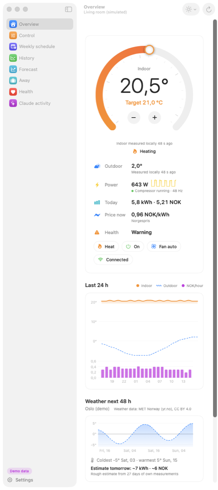
  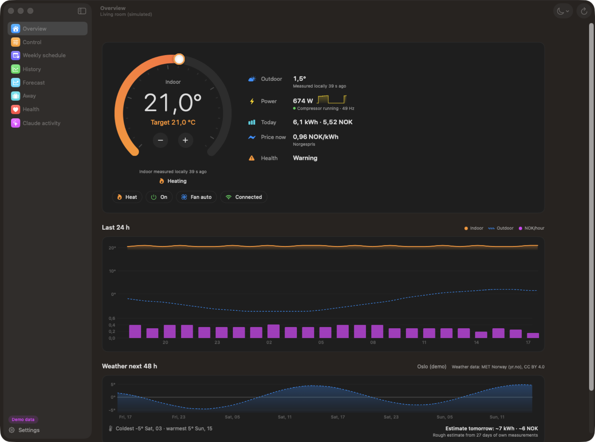
</p>

Husly (formerly Heat Pump / Varmepumpe) started as a better MELCloud app and now covers the home's climate and energy. It puts status, control, history, electricity cost, health, energy meters and indoor air in one tidy window, written for people who know nothing about heat pumps. Claude can read everything the app sees and suggest what to do, but you approve every change to the heat pump.

Built and tested with an **MSZ-RW25VG** with built-in Wi-Fi. Other air-to-air models in classic MELCloud should work too, but are untested. The app is in English and Norwegian. Electricity prices, grid tariffs and the weather forecast are for Norway.

## Contents

- [Features](#features)
- [Screenshots](#screenshots)
- [Install](#install)
- [Getting started](#getting-started)
- [Connect Claude](#connect-claude)
- [How it works](#how-it-works)
- [Security and privacy](#security-and-privacy)
- [Development](#development)
- [Making a release](#making-a-release)
- [License](#license)

## Features

- **Overview** – a thermostat ring you can drag, indoor and outdoor temperature, power, today's consumption and cost, the electricity price right now, what the heat pump is doing (heating, resting, defrosting) and the weather forecast for the next 48 hours.
- **Control** – on/off, mode, temperature (slider and stepper), fan speed and airflow direction. Changes are sent automatically a couple of seconds after you stop adjusting.
- **Weekly schedule** – create and edit the weekly schedule in MELCloud: events per weekday with time, on/off, mode, temperature, fan and airflow direction, copying a day, and ready-made templates (night setback, away during the day). The schedule runs in MELCloud, also when the Mac is off.
- **History** – temperature, energy and cost, operation and power, for 24 hours, 7 days, 30 days or one year.
- **Forecast** – the weather for the next 48 hours and nine days ahead, electricity prices a week ahead (published prices and a clearly marked estimate for the days after), expected consumption and cost per day, and price control.
- **Price control** – lowers the target temperature in expensive hours and sets it back afterwards. Works only while the app is running and the Mac is on and awake; with price control on, the app stays in the menu bar when the window is closed.
- **Electricity cost** – Norgespris (fixed price), spot price through Tibber or spot price from hvakosterstrommen.no, with grid tariff and electricity subsidy. Prices are colored from very cheap to very expensive.
- **Health** – an error log with explanations, filter-cleaning reminders and warnings about short cycling, unusually high consumption, frequent defrosting, weak Wi-Fi and firmware. Firmware updates of the Wi-Fi adapter can be started and followed here.
- **Away** – frost protection and holiday mode.
- **Local connection** – reads power, compressor, defrosting and an accurate energy meter directly from the Wi-Fi adapter on the home network. Read-only.
- **Household electricity use** – from Tibber, with the heat pump's share.
- **Energy meter (Tibber)** – optional: choose Add Device… (sidebar, File menu or Settings → Devices) → Tibber, and your Tibber home appears as a device with live power (with Tibber Pulse or Watty), today's use and cost, and history per hour and day. It uses the same token as the Tibber prices.
- **Indoor air quality (Airthings)** – optional: choose Add Device… → Airthings and enter the client ID and secret of an API client you create on Airthings' developer site. Each sensor appears as a device with radon (short- and long-term average), CO₂, VOC, particles, humidity, temperature and air pressure, levels (good/fair/poor, from your own thresholds in the Airthings app), advice, history up to two years, a Home card and an optional notification when the long-term radon average reaches 100 Bq/m³. Read-only. Claude can read it too (`get_air_quality`, `get_air_quality_history`).
- **Claude** – a built-in MCP server with 25 tools, a health check and knowledge documents about maintenance and error codes.
- **Menu bar** – optional (Settings → General → Menu bar): the mode, temperatures, power, cost or price in the menu bar, as you choose, and a panel with status, today's numbers, health and the controls. The app then keeps running when the window is closed.
- **Light and dark mode** – one click in the toolbar or ⌘⇧L.
- **English and Norwegian** – follows the macOS language, or choose under Settings → General → Language.

## Screenshots

| Home with several devices | Indoor air (Airthings) |
|---|---|
| 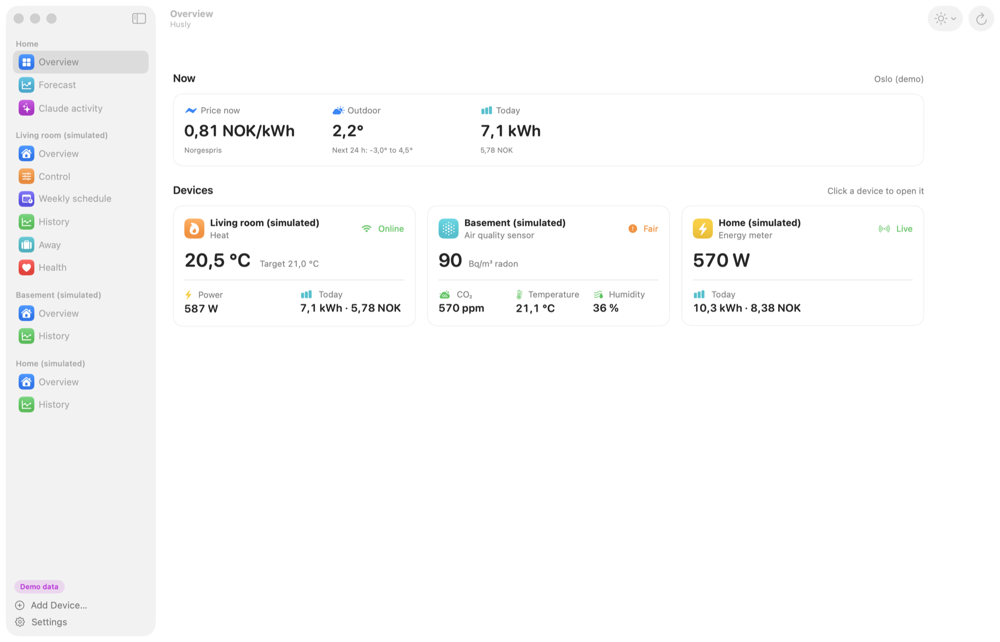 | 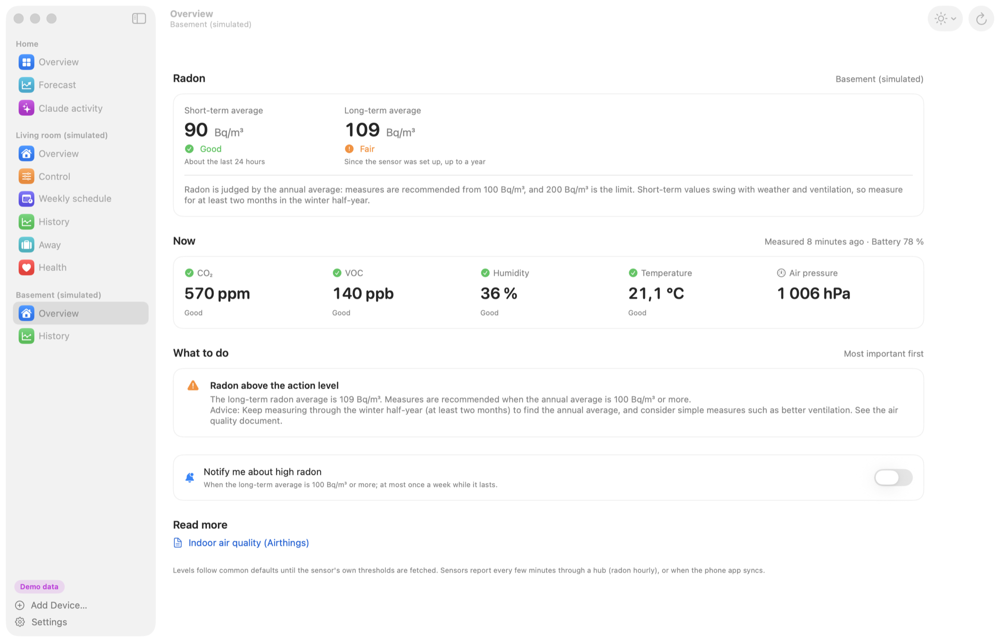 |

**Menu bar.** The item shows what you choose (here mode, indoor temperature and power): 

| Menu bar panel, light | Menu bar panel, dark |
|---|---|
| 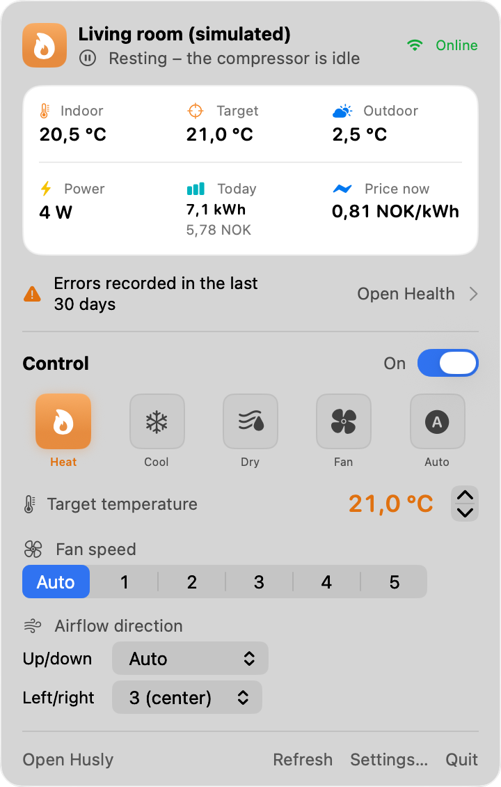 | 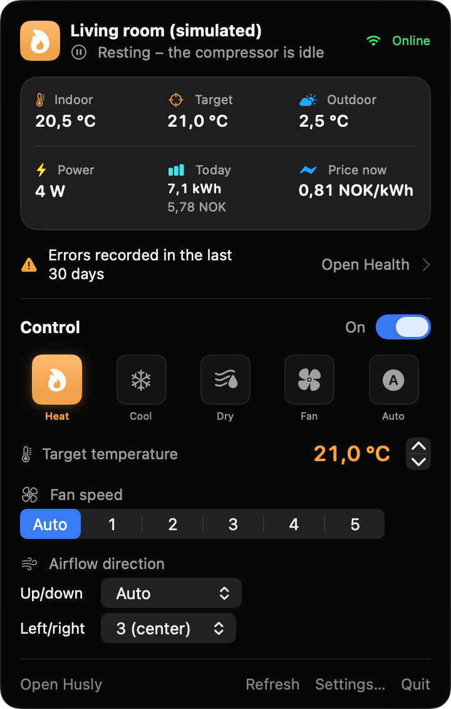 |

**Add Device** (sidebar, File menu or Settings → Devices):

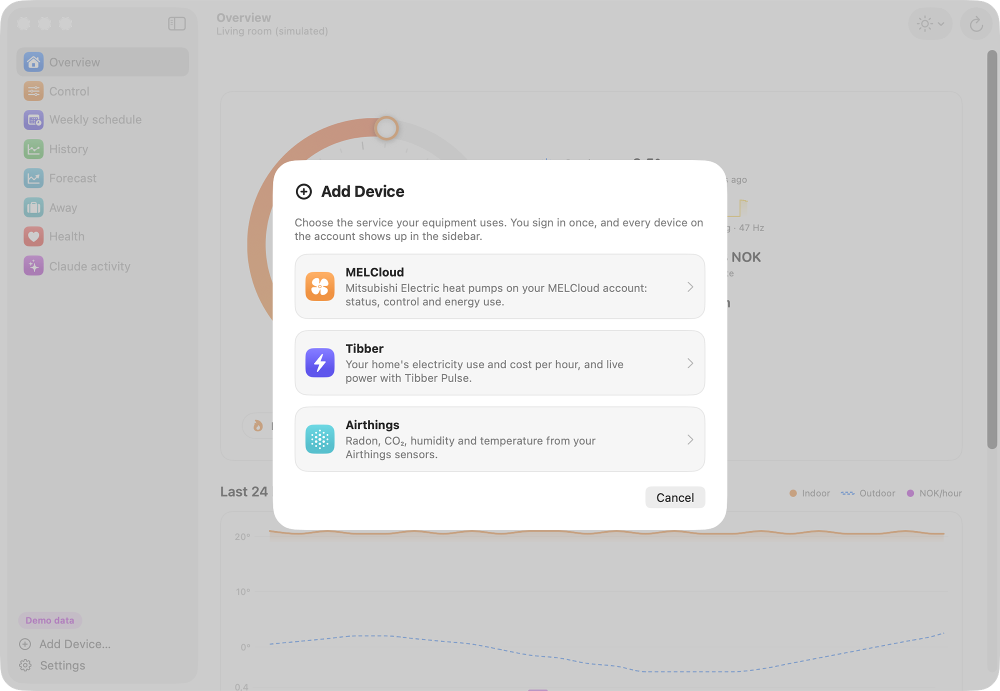

| Control | Health |
|---|---|
| 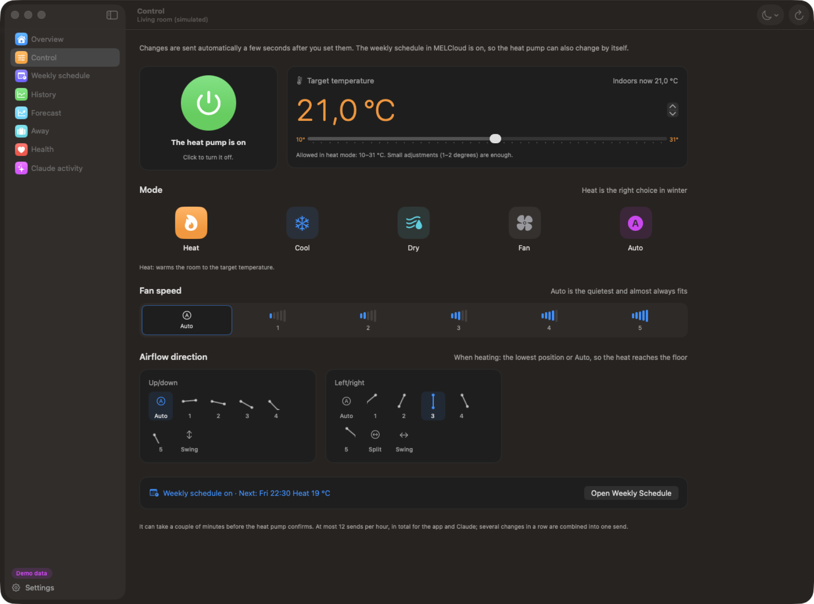 | 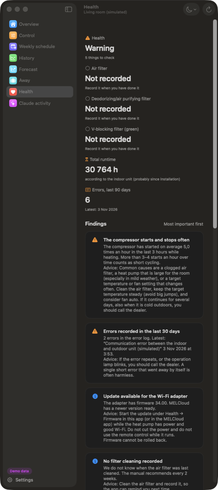 |

| History: temperature | History: energy and cost |
|---|---|
| 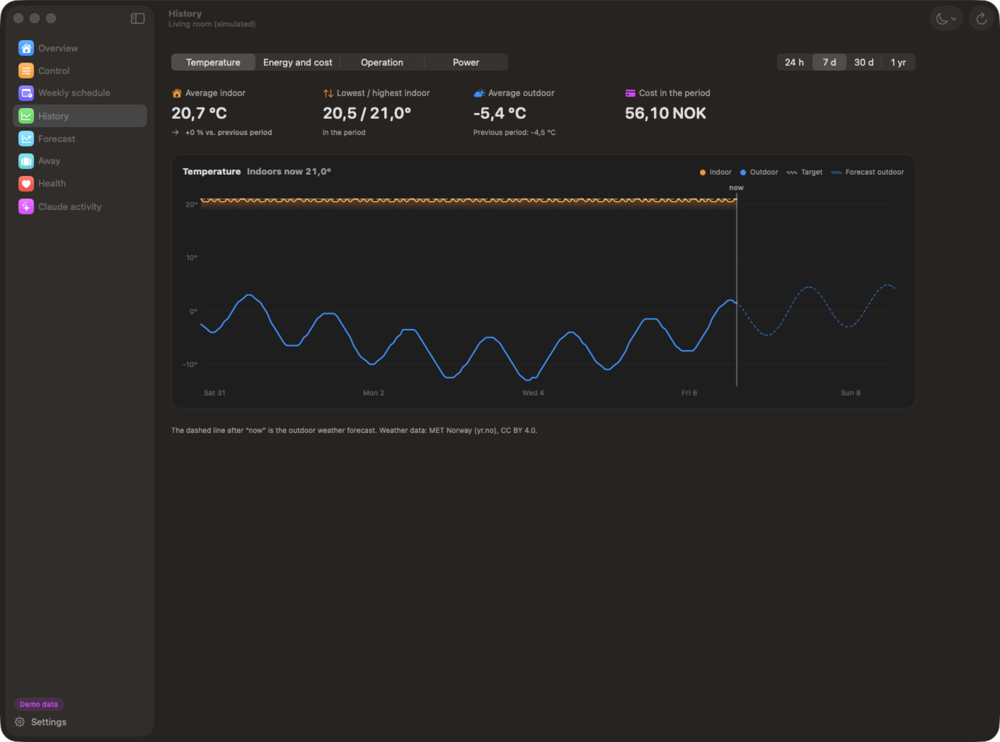 | 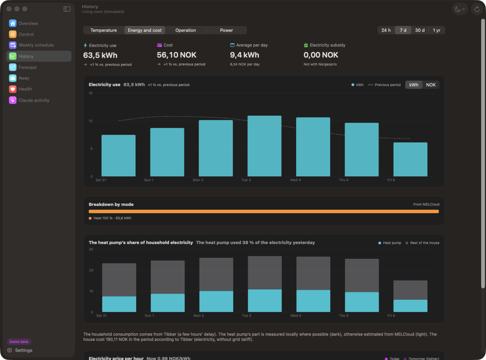 |

| History: power | History: operation |
|---|---|
| 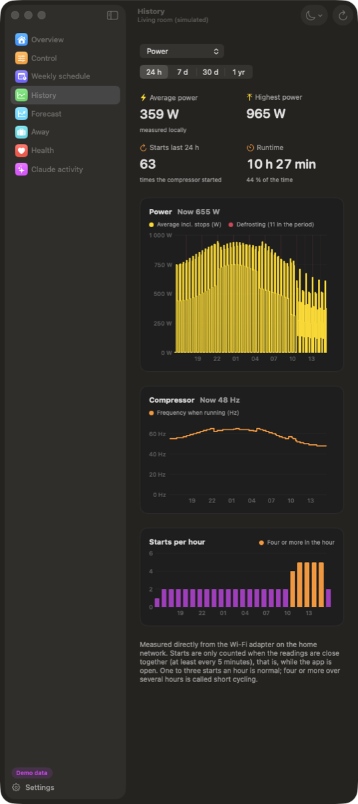 | 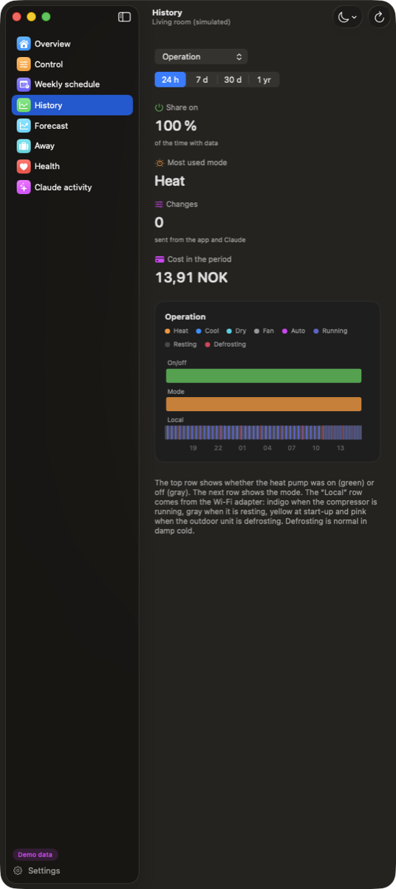 |

| Away | Settings: electricity price |
|---|---|
| 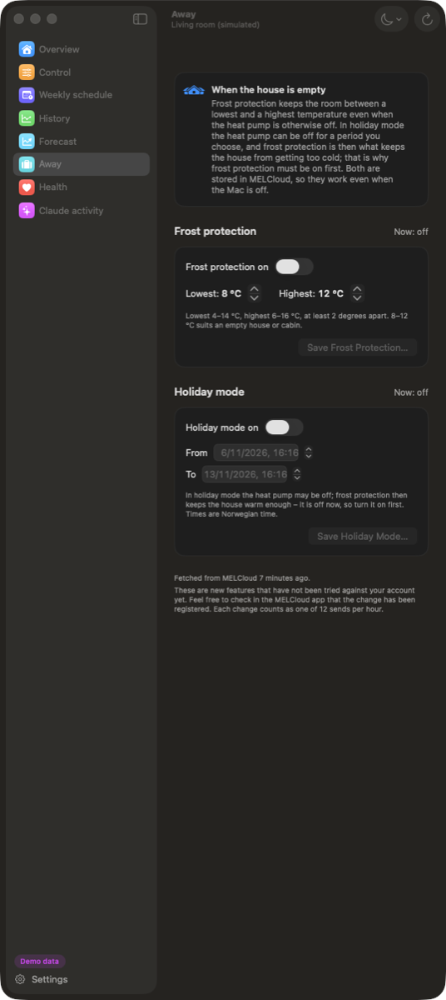 | 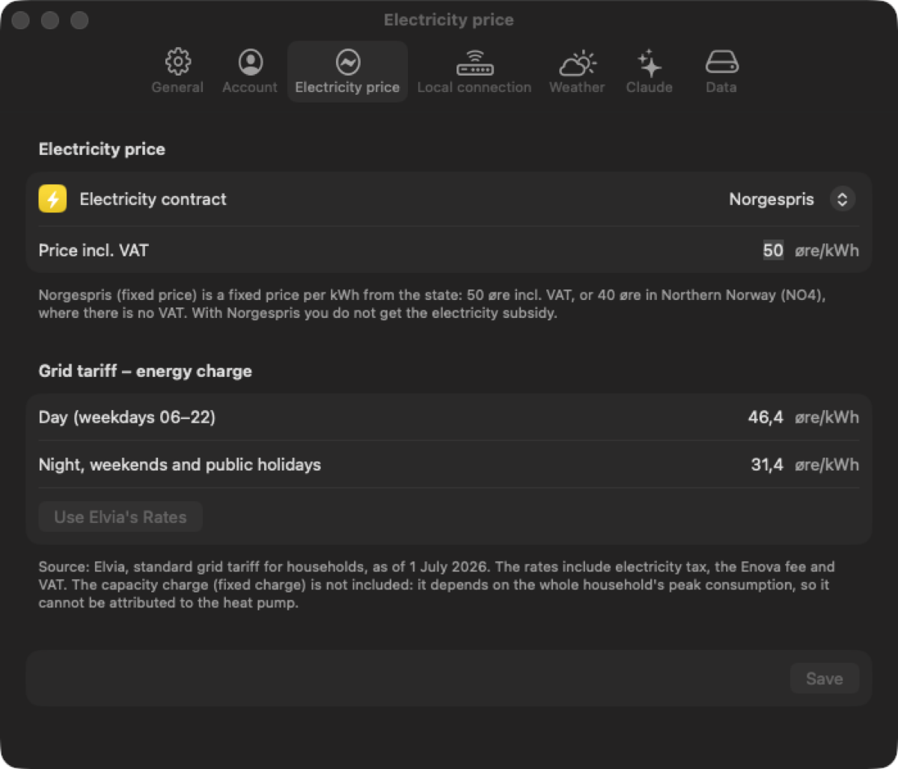 |

The screenshots are taken in demo mode with simulated data.

## Install

1. Download `Husly-<version>.dmg` from the [latest release](https://github.com/stigoleg/Husly/releases/latest).
2. Open it and drag Husly to Applications.

Already have Heat Pump (Varmepumpe) 1.1.5 or later? It updates itself to Husly in place and keeps its location (`Varmepumpe.app`), sign-in, history and Claude setup, so you do not need the disk image.
3. Open the app. It is signed with a Developer ID and notarized by Apple, so it opens without a warning.

Requires macOS 26 or later, on Apple silicon or Intel.

From version 1.1.5 the app updates itself. It checks GitHub for new versions once a day, downloads them and installs them when you quit the app. You can also choose “Install and Restart”. A download is only used when its checksum matches and the app is signed and notarized by the same developer. The setting and the “Check Now” button are under Settings → General, and the Husly menu has “Check for Updates…”.

## Getting started

1. **Sign in** with the same email and password as in the MELCloud app. The sign-in is stored in the keychain on your Mac.
2. **Choose an electricity contract** under Settings → Electricity price: Norgespris, spot price through Tibber (requires a [personal token](https://developer.tibber.com/settings/access-token)) or spot price without Tibber. The grid tariff is prefilled with Elvia's rates and can be changed.
3. **Turn on the local connection** (optional) under Settings → Local connection → **Find Automatically** → **Test**. macOS asks for access to the local network; answer Allow.
4. **The location for the weather forecast** comes from MELCloud. To use a different place, search for an address or place under Settings → Weather, or click in the map.

**Language.** The app uses the macOS language: Norwegian on a Norwegian Mac, English otherwise. Under Settings → General → Language you can choose English or Norwegian regardless; the change takes effect when the app restarts. The Claude helper follows the same choice, so the approval window and health texts appear in that language too. Text that is already stored, such as reasons in the change log, stays in the language it was written in.

The app fetches data only while its window is open, and quits when you close it. The exceptions are the menu bar item (Settings → General → Menu bar) and price control: while either is on, the app keeps running in the menu bar, without a Dock icon while the window is closed when the menu bar item is on. Polling pauses while the Mac sleeps. Claude can still read when the app is closed.

## Connect Claude

Settings → Claude shows the command with the right path and a copy button:

```sh
claude mcp add varmepumpe --scope user -- "/Applications/Husly.app/Contents/Helpers/varmepumpe-mcp"
```

If you updated from Heat Pump (Varmepumpe), the app is still at `/Applications/Varmepumpe.app` and the command you already added keeps working.

Restart Claude Code and ask, for example, “Run a health check on the heat pump”. The first time, macOS asks whether the MCP server may read the sign-in in the keychain; choose **Always Allow**.

When Claude wants to change something, your Mac shows a separate window, “Claude wants to change the heat pump”, with the change and Claude's reason. The change is sent only if you click **Approve**. Reject, Esc or no answer within two minutes stops it. This applies whatever permission mode Claude Code runs in. Even so, do not add the `set_*` tools or `start_firmware_update` to the list of tools allowed without asking.

<details>
<summary>Tools and resources for Claude</summary>

- **Read:** `get_status`, `get_live_status`, `get_health_report`, `get_error_log`, `get_history`, `get_energy`, `get_prices`, `get_forecast`, `get_house_consumption`, `get_maintenance_status`, `get_away_settings`, `get_weekly_timer`, `get_firmware_status`, `get_change_log`, `get_device_info`, `refresh`
- **Change (with approval):** `set_power`, `set_mode`, `set_temperature`, `set_fan_speed`, `set_vanes`, `set_frost_protection`, `set_holiday_mode`, `start_firmware_update`, `record_maintenance`
- **Prompt:** `helsesjekk` – a full health check with a prioritized summary
- **Resources:** `varmepumpe://knowledge/…` – heat pump profile, maintenance, error codes, when to call the dealer, and advice on safe operation

</details>

## How it works

```
Husly.app (SwiftUI)               varmepumpe-mcp (stdio, in Contents/Helpers)
        \                                  /
         HeatPumpKit (Swift package)
           HeatPumpService – cache, traffic limits, audit log
           MELCloud client (control) · local client (read-only) · Tibber · Airthings · MET
           HistoryStore    – SQLite in ~/Library/Application Support/Varmepumpe/
           HealthEngine    – rule-based health assessment
           Knowledge/      – knowledge used by the app and Claude (English and Norwegian)
```

The app and the MCP server share one database, so there is one cache, one history and one shared limit on traffic to MELCloud, whoever asks.

<details>
<summary><b>Electricity price and cost</b></summary>

- **Norgespris:** a fixed price per kWh (default 50 øre incl. VAT, 40 øre in NO4). No electricity subsidy.
- **Spot price through Tibber:** hourly prices from Tibber with your personal token.
- **Spot price without Tibber:** hourly prices from hvakosterstrommen.no for the chosen price area, with your supplier's markup. VAT is added (not in NO4).

The energy charge of the grid tariff is prefilled with Elvia's household rates from 1 July 2026: day 46.40 øre and night/weekend/public holiday 31.40 øre, incl. taxes and VAT. The capacity charge is not included, because it depends on the whole household's peak use. For spot contracts the electricity subsidy is deducted: the state covers 90 % of the hourly price above 96.25 øre/kWh incl. VAT (2026).

Cost = consumption × (electricity + grid tariff − subsidy). With the local connection, measured consumption per hour is used. Otherwise the day's consumption is priced at the day's average price, and the amount is marked “estimate”. Prices are fetched at most once an hour.

</details>

<details>
<summary><b>Local connection</b></summary>

The Wi-Fi adapter also answers directly on the home network. The app can read it there in addition to MELCloud. That gives power in watts, compressor frequency and starts, defrosting, faster temperatures, the error code from the indoor unit and an energy meter with 0.1 kWh resolution.

- **Read-only, enforced in code.** The client has one operation: a status request (`<CSV></CSV>` to `/smart`). It never sends the `CONNECT` setting (which can disconnect the adapter from MELCloud), commands, restarts or admin requests. All control goes through MELCloud.
- Only private IPv4 addresses, no redirects, and only answers from the address it asked.
- Reads only when the Mac is on the same network as the heat pump. Away from home, local reading pauses.
- At most one request per 20 seconds, shared by the app and Claude, with longer pauses after errors.
- The MAC address and serial number are removed right after decryption and are never stored or shown.
- The endpoint is unofficial and may stop working after a firmware update. The rest of the app then works as before.
- Off by default.

The health rules for short cycling, consumption per degree and defrosting are based on these readings. The limits are rules of thumb and are described in the maintenance knowledge document.

</details>

<details>
<summary><b>Away</b></summary>

- **Frost protection** keeps the room between a lowest (4–14 °C) and highest (6–16 °C) temperature while the heat pump is otherwise off.
- **Holiday mode** applies from and to a given time. Because the heat pump may be off during that period, holiday mode can only be turned on while frost protection is on, and frost protection cannot be turned off while holiday mode applies.

Each change is confirmed in a separate window and logged. After a change, the page shows both what was sent and what MELCloud reads back. Compare with the MELCloud app the first time.

</details>

<details>
<summary><b>Weather forecast and estimates</b></summary>

Hourly forecast from [MET Norway](https://api.met.no/) (the same source as yr.no), license CC BY 4.0. The position is rounded to about 1 km before it is sent to MET. The place search and the map in the settings use Apple Maps, so what you search for is sent to Apple. The app fetches at most once an hour and respects MET's caching rules. You can enter a contact email for MET under Settings → Weather; it is never filled in automatically.

The estimate for tomorrow's consumption and cost is based on the relationship between consumption and degree days over the last 45 days, and appears once there are at least 10 days of data. Forecast shows the same estimate for each day in the forecast, up to seven days ahead.

**Price estimate.** For the hours after the published prices (tomorrow's arrive around 13:00), Forecast shows an estimate: the hourly profile of the last 28 days (weekdays and weekends/public holidays separately), scaled to the average of the last week. If the daily price has followed the outdoor temperature over the last 30 days (|r| ≥ 0.4, at least 14 days), the level is shifted with the weather forecast. The band around the estimate is the 25th–75th percentile of the errors the method would have made over the last weeks. Requires at least 14 days of stored prices; with Norgespris it is not needed.

</details>

<details>
<summary><b>Price control</b></summary>

Turned on under Forecast. In hours that Tibber (or the app, against the average of the last 72 hours) marks as expensive, the target temperature is lowered by 1 °C, in very expensive hours by 2 °C, never below a lowest temperature (default 18 °C), and for at most eight hours a day (the most expensive ones; can be changed). Optional: +1 °C in up to two of the cheapest hours in the four hours before an expensive period. The base is the temperature in the weekly schedule when it is on, otherwise the temperature you last set yourself.

- Uses only published prices, never the estimate, and only in heat mode. On/off and mode are never changed.
- At most one change per hour and four within an hour, and only when the plan shifts. If a change fails, it is tried once more later in the same period. It holds back while holiday mode is on, while the heat pump is off, while MELCloud has blocked traffic, and for ten minutes around weekly schedule events.
- If you change the temperature yourself (in the app, with the remote or in MELCloud), it pauses until the next shift, and your temperature becomes the new base temperature. Changes made by the weekly schedule do not count as yours.
- When it is turned off, before the Mac sleeps and when the app quits, the temperature is set back first. If that does not happen (power cut, crash), the temperature stays where it was, but never below the lowest temperature. The next time the app starts, it follows the plan again.
- With price control on, the app does not quit when the window is closed. It stays in the menu bar with the price now, temperature, status and next step, and from there you can open the window, turn price control off or quit. With the menu bar item on (Settings → General → Menu bar), price control's status is in its panel instead.
- Changes are logged with the source “Price control” and count toward the 12 changes per hour. Claude can read the status and plan (`get_prices`), but cannot change them.

</details>

<details>
<summary><b>Changes are sent automatically</b></summary>

Changes in Control and on the thermostat are sent about 2 seconds after the last adjustment. Several adjustments are combined into one send, and if you set a value back to the current one, nothing is sent. The badge at the top shows “Changed…”, “Sending…”, “Sent – waiting for the heat pump”, “Confirmed” or the error. Each send contains the whole settings object from MELCloud, so fields you did not change keep their values.

</details>

## Security and privacy

- **Claude reads freely, but changes only with approval** in the window on your Mac. Every change is logged with its source (app, Claude or price control), old and new value, reason and result, and shown under Claude activity.
- **Polite to MELCloud.** Status is fetched at most once a minute and reused for 10 minutes. At most 12 changes per hour, at least 5 seconds apart. On “too many requests” (HTTP 429) all traffic stops until the block is over, and on a rejected password all fetching stops until a new sign-in is saved.
- **Secrets** (MELCloud sign-in, session, Tibber token and Airthings client ID and secret) are kept in the macOS keychain, never in plain text on disk.
- **Other services:** MET Norway (weather), Tibber (prices and consumption, only with a token; live power over one connection while the app runs, only with the energy meter turned on), Airthings (only when added: a token from accounts-api.airthings.com with your client ID and secret, then the newest values of all sensors at most every 5 minutes, each sensor's hourly history at most hourly and its thresholds daily, from consumer-api.airthings.com), hvakosterstrommen.no (prices), Apple Maps (place search in the settings) and GitHub (new versions, once a day). No analytics or tracking.
- **No official error-code table** for the MSZ-RW is public. The explanations of error codes are therefore marked with how certain they are.

Husly is not made by or affiliated with Mitsubishi Electric, Tibber or Airthings. MELCloud is a trademark of Mitsubishi Electric.

## Development

Requires Xcode 27 (Swift 6.4), macOS 26 and [XcodeGen](https://github.com/yonaskolb/XcodeGen) (`brew install xcodegen`). `project.yml` is the source; the `.xcodeproj` is generated and not checked in.

```sh
make build     # signed Release build in build/DerivedData
make test      # the HeatPumpKit unit tests
make install   # build and copy to /Applications (quit the app first)
make demo      # the app with simulated data and its own database in build/demo/
make check     # tests and a Debug build
make l10n      # refresh the string catalogs and list missing translations
make clean
```

Local builds are signed with “Apple Development” (team `49P95434EE`), with hardened runtime and without App Sandbox, so the app and the MCP server share the database and keychain.

**Demo mode** (`make demo`, or `VARMEPUMPE_BACKEND=mock`) gives a simulated heat pump with winter data, a local Wi-Fi adapter, prices, weather, household consumption and an occasional error. No calls go to MELCloud. `make demo LANGUAGE=nb` runs it in Norwegian.

**Languages.** English is the source language in the code; Norwegian bokmål is the translation. The app's strings are in `App/Resources/Localizable.xcstrings` (extracted by the compiler), and the strings from HeatPumpKit and the MCP server in `App/Resources/HeatPumpKit.xcstrings` (written with `L10n.tr("…")` and `L10n.format("…", …)`). `make l10n` updates the catalogs and lists strings without a Norwegian translation; `TRANSLATIONS=file.json` merges translations in (the format is described in `scripts/l10n.py`). CI and a unit test fail when a string lacks a Norwegian translation. The language is resolved in `HeatPumpKit/Support/L10n.swift`; the MCP helper reads the strings from the app bundle around it.

**The knowledge documents** in `Packages/HeatPumpKit/Sources/HeatPumpKit/Knowledge/<language>/*.md` (`en` and `nb`) are compiled into the code. Run `python3 Packages/HeatPumpKit/scripts/generate-knowledge.py` after changing them; a test fails if you forget.

**The app icon** is rendered from `App/Icon/AppIcon.svg` with `App/Icon/render.sh` (requires `brew install librsvg`).

**Screenshots and agents.** `scripts/screenshot.sh` takes a demo screenshot at a fixed window size, and `scripts/parity.sh` compares every screen before and after a change. [CLAUDE.md](CLAUDE.md) and [docs/architecture.md](docs/architecture.md) describe the architecture and its rules; project skills for [Claude Code](https://claude.com/claude-code) in `.claude/skills/` cover the design system, localization, screenshots and releases.

<details>
<summary>Environment variables</summary>

| Variable | Meaning |
|---|---|
| `VARMEPUMPE_BACKEND=mock` | Simulated heat pump. Without `VARMEPUMPE_DB_PATH` it uses its own database, `demo.sqlite` next to the real one, never the real one |
| `VARMEPUMPE_DB_PATH` | Path to the SQLite database |
| `MELCLOUD_EMAIL`, `MELCLOUD_PASSWORD` | Development only: sign in without the keychain |
| `VARMEPUMPE_APPROVAL=auto-approve` / `auto-reject` | Tests only: answers instead of the approval window. Works only with `VARMEPUMPE_BACKEND=mock`. |
| `VARMEPUMPE_SCREEN` | Start screen: overview, control, schedule, history, outlook, away, health, activity; with two or more devices also `home`, `home/forecast`, `home/activity` and `<device key>/<screen>` (e.g. `demo:100002/control`) |
| `VARMEPUMPE_HISTORY_TAB` | Start tab in History: temperature, energy, energy-kr, operation, power |
| `VARMEPUMPE_HISTORY_RANGE` | Start period in History: day, week, month, year |
| `VARMEPUMPE_SCROLL_TO` | Scrolls to a section after three seconds (screenshots) |
| `VARMEPUMPE_APPEARANCE` | `light`, `dark` or `system`, without saving the choice |
| `VARMEPUMPE_LANGUAGE` | `en` or `nb`, without saving the choice (also for the MCP server) |
| `VARMEPUMPE_SETTINGS_TAB` | Opens Settings on a tab: generelt, konto, enheter, strompris, lokal, vaer, claude, data |
| `VARMEPUMPE_MOCK_CYCLING=short` | The simulated compressor runs in short cycles |
| `VARMEPUMPE_DEMO_DEVICES` | Simulated devices, comma-separated (default `heatpump`); `heatpump,heatpump` adds a second heat pump (“Bedroom (simulated)”), `heatpump,meter` a simulated Tibber home (“Home (simulated)”, key `demo-meter:home`), `heatpump,airthings` a simulated Airthings Wave Plus (“Basement (simulated)”, key `demo-airquality:2930000001`) |
| `VARMEPUMPE_SETTINGS_SHEET=add-integration` | Opens Add Device on the Devices tab (screenshots; with `VARMEPUMPE_SETTINGS_TAB=enheter`; `add-integration/<id>` opens on that service) |
| `VARMEPUMPE_ADD_DEVICE=1` | Opens Add Device in the main window (`=<id>`, e.g. `airthings`, opens on that service) |
| `VARMEPUMPE_MENU_BAR` | `on` or `off` overrides Settings → General → Menu bar without saving; `open` also opens its panel (screenshots) |

</details>

## Making a release

Releases are built, signed with a Developer ID, notarized and published by GitHub Actions ([`release.yml`](.github/workflows/release.yml)) when a tag like `v1.2.3` is pushed:

```sh
# Update CHANGELOG.md and the version in project.yml (MARKETING_VERSION), commit, then:
git tag v1.2.3
git push origin main v1.2.3
```

The workflow runs the tests, builds a universal app (Apple silicon and Intel), notarizes and staples it, and puts `Husly-1.2.3.dmg` (the download) and `Varmepumpe-1.2.3.zip` (what installed apps update from), each with its SHA-256, under Releases. The release notes come from CHANGELOG.md. Installed apps find the version through GitHub's “latest release”, so it must not be marked as a pre-release, and the zip file must be named `Varmepumpe-<version>.zip`.

It needs these secrets in the repository:

| Secret | Content |
|---|---|
| `MACOS_CERTIFICATE_P12` | base64 of an exported “Developer ID Application” certificate with its key (.p12) |
| `MACOS_CERTIFICATE_PASSWORD` | the password of the .p12 file |
| `NOTARY_KEY_P8`, `NOTARY_KEY_ID`, `NOTARY_ISSUER_ID` | App Store Connect API key (base64 of the .p8), or: |
| `NOTARY_APPLE_ID`, `NOTARY_PASSWORD` | Apple ID and app-specific password |

Locally, `make release VERSION=1.2.3 NOTARY_PROFILE=<profile>` does the same, with a profile stored with `xcrun notarytool store-credentials`.

## License

[GPL-3.0](LICENSE). You may use, change and share the program, but changed versions you share must also be open source under the same license.
